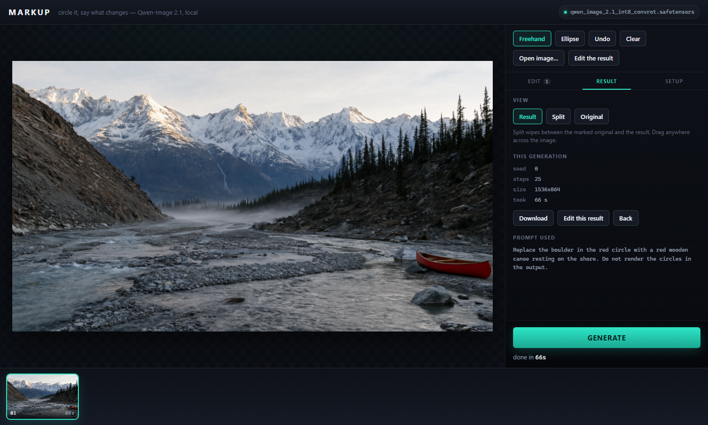

# Markup

Circle something in an image, say what should change, get it back. It runs locally on your own
GPU against a stock ComfyUI, using Qwen-Image 2.1's edit mode.



- Draw any number of freehand loops or ellipses. Each one gets its own colour.
- Write one instruction that refers to the marks by colour: *"replace the boulder in the red
  circle with a canoe, and remove the sign in the green circle"*.
- Hit Generate. A live progress dial follows ComfyUI's sampler.
- Compare before and after with a split wipe, then feed the result back in to keep editing.

Everything stays on your machine. Markup only talks to the ComfyUI you point it at.

## What you need

1. **ComfyUI 0.37.0 or newer**, running. This is the first release with the Qwen-Image 2.1 nodes.
   No custom nodes are needed.
2. **The three Qwen-Image 2.1 model files** from
   [Comfy-Org/Qwen-Image-2.1](https://huggingface.co/Comfy-Org/Qwen-Image-2.1), placed in your
   ComfyUI `models` folder:

   ```
   models/diffusion_models/qwen_image_2.1_int8_convrot.safetensors   7.26 GB
   models/text_encoders/qwen3vl_8b_int8_convrot.safetensors          9.35 GB
   models/vae/qwen_image_2.1_vae_bf16.safetensors                    0.68 GB
   ```

   The int4 diffusion model also works if it is the only one installed. If several are installed,
   the int8 one is preferred.

If ComfyUI is too old or a file is missing, Markup says which file and where it goes, and does
not start a generation.

## Install

### Option A: Windows, no Python needed

1. Download `Markup.exe` from the [latest release](https://github.com/loopforge0/qwen-image-markup/releases/latest).
2. Start ComfyUI.
3. Double-click `Markup.exe`. A console window opens and your browser goes to
   <http://127.0.0.1:8765>. Leave the console open while you use the app. Close it to stop.

> **"Windows protected your PC"?** The exe is not code-signed (signing costs money every year),
> so SmartScreen warns about it. Click **More info → Run anyway**. If you would rather not trust
> a downloaded binary, use Option B: it is the same code, and the exe is built from this repo by
> the GitHub Actions workflow in [`.github/workflows/release.yml`](.github/workflows/release.yml).
> Each release includes a `.sha256` checksum.

### Option B: from source (Windows, macOS, Linux)

You need Python 3.10 or newer. **There are no packages to install.** The server uses only the
standard library, and the page has no build step.

```bash
git clone https://github.com/loopforge0/qwen-image-markup.git
cd qwen-image-markup
python server.py
```

## Options

| Flag | Default | What it does |
|---|---|---|
| `--comfy` | `127.0.0.1:8188` | Address of a running ComfyUI. It can be on another machine. |
| `--port` | `8765` | Port for Markup's own page. |
| `--no-browser` | off | Don't open the browser on startup. |

Pass them to the exe the same way, e.g. `Markup.exe --comfy 192.168.1.20:8188`. You can also
change the ComfyUI address while the app runs, in **Setup → ComfyUI**. It is remembered next time.
A new address has to answer before it is kept, so a typo can't disconnect you.

ComfyUI on another machine works without a shared folder, because images go in through ComfyUI's
upload API. That machine has to be started with `--listen` so it accepts connections from the
network.

## Using it

1. Drop an image on the page, or click to choose one.
2. Draw a loop around each thing you want changed. Use **Freehand**, or **Ellipse** for a clean
   oval. **Undo** (or Ctrl+Z) removes the last mark.
3. In **Edit**, write the whole instruction, naming each mark by its colour. Click
   **+ don't draw the circles** to add the sentence that stops the model from painting your
   circles into the result.
4. Click **Generate**.

The **Result** tab shows the generation, a **Split** wipe against the marked original, and the
exact prompt that was sent. **Edit this result** makes the output the new starting image, so you
can chain edits. Every generation stays in the filmstrip at the bottom.

### Writing the instruction

The model was tested a lot while this was built. Two things matter most:

- **The noun sets how much changes. The circle only sets where.** Circle one panel of a jacket
  and write "replace the jacket with a leather biker jacket", and the whole jacket changes. Circle
  the same spot and write "turn the area in the red circle black", and only that patch changes.
  The loop does not have to contain the object. It only has to point at it.
- **Circles help most when words can't single something out.** One leaf among hundreds, one
  person in a crowd, a scuff or stain that is hard to describe. If there is only one of the thing
  and it has an obvious name, a plain sentence works as well as a circle.

### Settings (Setup tab)

- **Seed**: the same seed with the same marks and prompt gives the same result.
- **Steps**: 25 is the ComfyUI template default.
- **Size budget**: `0` keeps the image at its own size. `1024` is about 1 megapixel. `2048` is
  the model's native 2K, which on a 12 GB card takes many minutes per edit instead of about a minute.

### Saving and reproducing

- **Save / Load** writes a `.json` file with the clean image, every mark and the prompt. When
  you load it, the marks are still editable.
- **Export marked PNG** and **Copy** (the prompt) are enough to reproduce a result without
  Markup. Load that PNG as the reference image in a stock Qwen-Image 2.1 edit workflow, paste the
  prompt into `TextEncodeQwenImage21`, and use the same seed and steps. The app does nothing a
  plain workflow can't.

## Notes

- The numbered badges beside each mark are drawn on a separate layer and are never sent to the
  model. Only the coloured loops are.
- Your original file is never modified. Markup sends ComfyUI a flattened copy with the marks
  drawn on it.
- Markup only listens on `127.0.0.1` and rejects requests from other websites, so a page open in
  another tab can't drive it.
- Live progress needs ComfyUI's websocket. If that can't connect, the app still works and shows
  elapsed time instead of a percentage.

## Building the exe yourself

```powershell
powershell -ExecutionPolicy Bypass -File build.ps1
```

This puts PyInstaller in a throwaway `.venv-build` folder and writes `dist\Markup.exe`. To publish
a release, push a version tag. The workflow builds the exe on GitHub and attaches it:

```bash
git tag v1.0.0
git push origin v1.0.0
```

## License

MIT. See [LICENSE](LICENSE).
